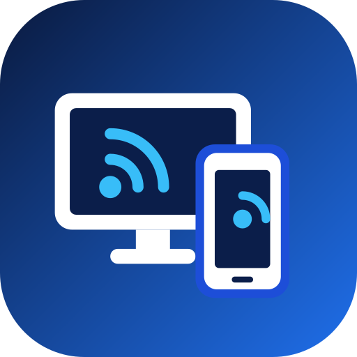
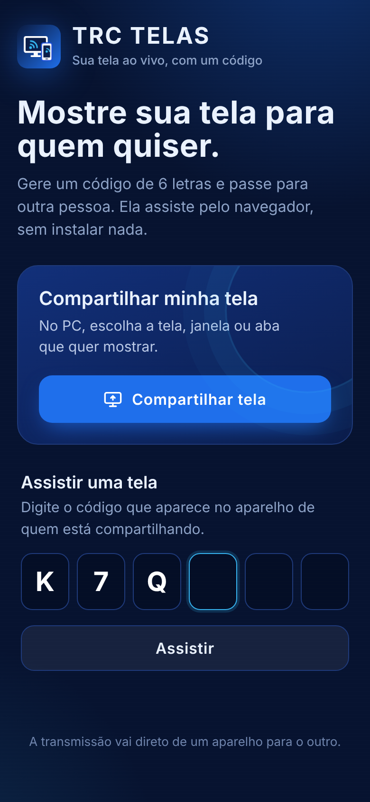
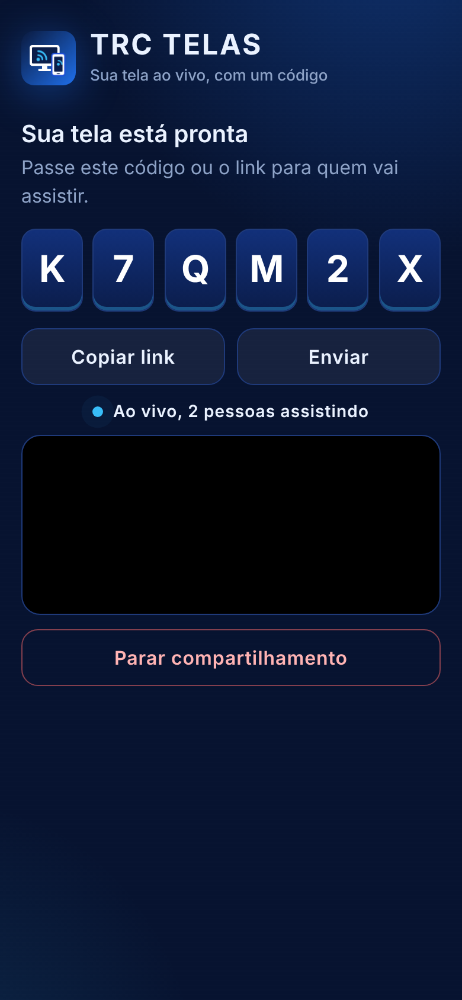

<p align="center">
  
</p>

<h1 align="center">TRC TELAS</h1>

<p align="center">
  Compartilhe a tela do celular Android ou do PC com um código de 6 letras.<br>
  Quem assiste abre um link no navegador e não precisa instalar nada.
</p>

<p align="center">
  <a href="https://trc-telas.vercel.app"><b>Abrir o site</b></a> ·
  <a href="https://github.com/rodriguesvieira378-byte/trc-telas/raw/main/apk/TRC-TELAS-2.0.apk"><b>Baixar o APK (20 MB)</b></a>
</p>

<p align="center">
  
  &nbsp;&nbsp;
  
</p>

## O que faz

- **Compartilhar pelo Android**: o app pede permissão para gravar a tela e gera um código.
- **Compartilhar pelo PC**: no Chrome ou Edge, escolha a tela, a janela ou a aba.
- **Assistir em qualquer aparelho**: Android, iPhone ou PC, direto no navegador, digitando o código ou abrindo o link `?sala=CÓDIGO`.
- **Mais de uma pessoa pode assistir** ao mesmo tempo, e quem compartilha vê quantas estão conectadas.

## Como funciona

```
 Celular / PC que compartilha            Quem assiste (navegador)
 ┌──────────────────────────┐            ┌──────────────────────┐
 │ captura da tela          │  WebRTC    │                      │
 │  • PC: getDisplayMedia   │ ─────────▶ │  <video> ao vivo     │
 │  • Android: MediaProjection           │                      │
 └────────────┬─────────────┘            └──────────┬───────────┘
              │       "aperto de mão" inicial       │
              └──────────▶  servidor PeerJS  ◀──────┘
```

- **WebRTC (PeerJS)**: o vídeo vai direto de um aparelho para o outro. O servidor público do PeerJS só ajuda os dois a se encontrarem.
- **Android (Java)**: um `Foreground Service` captura a tela com a **MediaProjection** e envia com o **WebRTC nativo** (codificação de vídeo por hardware). A sinalização é feita em Java, por WebSocket, com o mesmo protocolo do site.
- **Web**: a mesma página (`web/index.html` + `web/app.js`) roda no site e dentro do APK.
- **Qualidade**: Econômico (15 fps), Normal (30 fps) e Fluido (60 fps), no site e no app.

## Estrutura

```
app/        projeto Android (Java, WebView, MediaProjection)
web/        site publicado na Vercel (index.html + app.js)
docs/       imagens do README
GERAR-APK.bat  gera o APK no Windows com dois cliques
```

## Gerar o APK

**Windows:** dê dois cliques em `GERAR-APK.bat`. Ele usa o Java 17/21 e o Android SDK do Android Studio. O arquivo sai como `TRC-TELAS.apk` na mesma pasta.

**Android Studio:** abra a pasta do projeto e use *Build → Build APK(s)*.

Requisitos: Android 7.0 ou mais novo (API 24). Compila com Gradle 8.7 e Android Gradle Plugin 8.5.

## Limitações conhecidas

- O áudio do celular não é transmitido, só a imagem.
- O fps real depende do aparelho e da internet: em celular fraco ou rede ruim, ele diminui sozinho.
- Em redes muito fechadas (algumas redes de escola ou 4G), a conexão direta pode falhar. Nesse caso é preciso um servidor TURN.
- iPhone só assiste: o iOS não deixa sites capturarem a tela.

---

Feito por **Cassio Vieira**, Técnico em Redes de Computadores e dev.
